  

   

  

    
    
    
    
  

---

### ⚡ About Me

I am a **Full-Stack Software Engineer & AI Engineer** specializing in architecting reliable, high-performance enterprise systems and deploying real-time **Computer Vision & Machine Learning** pipelines into production web and mobile applications.

- 🏢 **Current Role:** **Full-Stack Developer** at **PT Dwi Putra Sakti** — engineering automated payroll & attendance (HRIS), supply chain tracking, and multi-warehouse inventory systems (`React.js`, `Django`, `Laravel`, `SQL`).
- 🏛️ **Previous Experience:** **Back-End Web Developer** at **Biro Sistem Informasi & Digitalisasi UMM** — designing scalable **Academic Information System (SIAKAD)** RESTful APIs and **PostgreSQL** architectures with `Laravel`.
- 🎓 **Education & Mentorship:** **B.Sc. in Informatics Engineering** from **University of Muhammadiyah Malang** (**GPA 3.88 / 4.00**) • Former **Laboratory Assistant & Treasurer** at Informatics & Infokom Labs UMM.
- 🧠 **Applied AI Focus:** End-to-end **YOLOv12** object detection, **PyTorch** deep learning, **Transformer NLP** (`BERT` / `DistilBERT`), **Explainable AI (XAI)**, and cybersecurity anomaly detection.

---

### 🛠️ Technical Arsenal

#### 🧠 AI, Computer Vision & Machine Learning

  
  
  
  
  
  

#### ⚙️ Backend & API Architecture

  
  
  
  
  
  

#### 💻 Frontend & Cross-Platform Mobile

  
  
  
  
  
  

#### 🗄️ Databases, DevOps & Tooling

  
  
  
  
  
  

---

### 🚀 Featured Open-Source Projects

<table>
  <tr>
    <td width="50%" valign="top">
      <h4>🚘 <a href="https://github.com/fitraaromeo/Otoscan-AI">OtoScan AI</a></h4>
      
<b>Microservices AI Vehicle Inspection System</b> — Multi-platform monorepo where Flutter captures 4-side vehicle imagery, orchestrated via a Go Fiber REST API to a Python FastAPI YOLOv12 inference engine detecting 6 damage classes in real time.

      
<code>Flutter</code> <code>Go Fiber</code> <code>FastAPI</code> <code>YOLOv12</code> <code>PostgreSQL</code>

    </td>
    <td width="50%" valign="top">
      <h4>🌐 <a href="https://github.com/fitraaromeo/otoscan-web">OtoScan Web</a></h4>
      
<b>Hybrid Web Platform for OtoScan AI</b> — Next.js 14 App Router dashboard sharing the Go Fiber &amp; PostgreSQL core with zero backend duplication. Features live camera YOLOv12 bounding-box preview, 4-side vehicle scanner, and full CRUD operations.

      
<code>Next.js 14</code> <code>TypeScript</code> <code>Go Fiber</code> <code>YOLOv12</code> <code>PostgreSQL</code>

    </td>
  </tr>
  <tr>
    <td width="50%" valign="top">
      <h4>🔍 <a href="https://github.com/fitraaromeo/car-damage-detection-using-yolov12n">Car Damage Detection (YOLOv12n)</a></h4>
      
<b>Real-Time Vehicle Damage Severity Classifier</b> — Computer Vision web engine powered by custom-trained YOLOv12n object detection and FastAPI to localize and classify automotive surface damage with low-latency inference.

      
<code>YOLOv12n</code> <code>FastAPI</code> <code>OpenCV</code> <code>Python</code>

    </td>
    <td width="50%" valign="top">
      <h4>📰 <a href="https://github.com/fitraaromeo/Fake-News-Detection">Fake News Detection (NLP)</a></h4>
      
<b>Deep Learning &amp; Transformer Text Classification</b> — Comparative NLP pipeline evaluating LSTM, BERT, and DistilBERT models on news corpora using PyTorch, TensorFlow, and HuggingFace Transformers, deployed via Streamlit.

      
<code>BERT</code> <code>DistilBERT</code> <code>LSTM</code> <code>PyTorch</code> <code>Streamlit</code>

    </td>
  </tr>
  <tr>
    <td width="50%" valign="top">
      <h4>🏘️ <a href="https://github.com/fitraaromeo/iuran-hub">Iuran Hub</a></h4>
      
<b>Digital Community Finance Platform</b> — Full-stack financial management system built to track neighborhood funds, resident dues, and transparent cash-flow reporting.

      
<code>Laravel</code> <code>React.js</code> <code>MySQL</code> <code>REST API</code>

    </td>
    <td width="50%" valign="top">
      <h4>✨ <a href="https://github.com/fitraaromeo/portfolio-web">Interactive Portfolio (Fitra OS)</a></h4>
      
<b>Personal Engineering Showcase</b> — Modern dark-slate portfolio featuring an interactive CLI terminal console, project architecture breakdowns, and responsive glassmorphic UI.

      
<code>TypeScript</code> <code>Next.js / React</code> <code>Modern CSS</code> <code>Vercel</code>

    </td>
  </tr>
</table>

#### 🔒 Selected Enterprise & Internal Systems
- **Enterprise HRIS, Payroll & Supply Chain Suite (`PT Dwi Putra Sakti`)** — Automated payroll & tax calculation, real-time employee attendance, and factory-to-store multi-warehouse inventory tracking (`React.js`, `Django`, `Laravel`, `SQL`).
- **Academic Information System APIs (`SIAKAD UM Manado` & `UMM`)** — High-availability RESTful API backend and normalized relational database schemas supporting university academic workflows (`Laravel`, `PostgreSQL`).
- **Honeypot Cybersecurity Anomaly Detection** — Unsupervised `Isolation Forest` pipeline with 10+ engineered security features classifying 7 cyber-attack vectors across Critical-to-Low severity tiers (`Python`, `Scikit-Learn`).

---

### 💼 Experience & Academic Highlights

| Period | Role | Organization | Key Focus |
| :--- | :--- | :--- | :--- |
| **Sep 2026 – Present** | **Full-Stack Developer** | **PT Dwi Putra Sakti** | Enterprise HRIS, automated payroll/attendance, supply chain & multi-warehouse inventory (`React`, `Django`, `Laravel`, `SQL`) |
| **Jul 2025 – Sep 2026** | **Back-End Web Developer** | **Biro Sistem Informasi & Digitalisasi UMM** | Academic Information System (SIAKAD) RESTful APIs & relational database administration (`Laravel`, `PostgreSQL`) |
| **Sep 2024 – Jul 2026** | **Laboratory Assistant & Treasurer** | **Informatics & Infokom Labs UMM** | Instructed CS & Python programming labs, mentored students in live debugging, and managed lab financial accountability |
| **Sep 2022 – Aug 2026** | **B.Sc. in Informatics Engineering** | **University of Muhammadiyah Malang** | **GPA: 3.88 / 4.00** — Specialization in AI, Deep Learning, Computer Vision, NLP & Software Engineering |

---

### 📊 GitHub Activity & Metrics

  
  

---

  Built with precision by <b>Fitra Romeo Winky</b> • Explore full case studies at <a href="https://portfolio-fitra-romeo-winky.vercel.app/">portfolio-fitra-romeo-winky.vercel.app</a>

